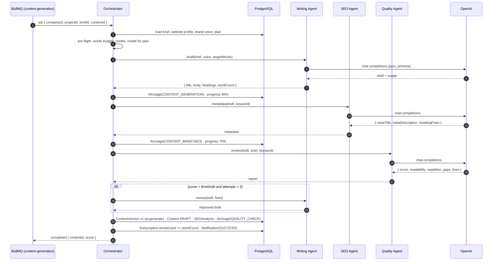

# AI Agents

The worker runs a small set of specialised agents coordinated by an Orchestrator. Agents are **functions with a prompt, a typed input and a schema-validated output** — not autonomous chat loops. This document defines what each agent does, how they are orchestrated, how prompts are designed, how cost is controlled and what happens when things fail.

## Table of contents

- [1. Agents at a glance](#1-agents-at-a-glance)
- [2. Orchestration](#2-orchestration)
- [3. Agent specifications](#3-agent-specifications)
- [4. Prompt design principles](#4-prompt-design-principles)
- [5. Structured outputs](#5-structured-outputs)
- [6. Model selection](#6-model-selection)
- [7. Cost control and usage accounting](#7-cost-control-and-usage-accounting)
- [8. Failure handling](#8-failure-handling)
- [9. Evaluation](#9-evaluation)
- [10. Code layout](#10-code-layout)

## 1. Agents at a glance

| Agent | Purpose | Consumes | Produces | `AIFeature` |
| --- | --- | --- | --- | --- |
| **Research** | Find keyword opportunities for a topic | topic, seed keywords, website business profile, country/language | clusters (`pillar`, intent), keywords with estimated volume/difficulty, 0–100 opportunity score; website analysis summary | `KEYWORD_RESEARCH`, `WEBSITE_ANALYSIS` |
| **SEO** | Turn a keyword into an on-page plan and metadata | keyword/cluster, intent, competitors, business profile | brief outline (H2/H3 tree), FAQ questions, secondary keywords, `metaTitle`, `metaDescription`, heading fixes | `CONTENT_BRIEF`, `SEO_ANALYSIS` (suggestions) |
| **Writing** | Produce and transform prose | brief, brand voice, target words, selection + action | full draft (HTML/Markdown), rewritten/expanded/shortened/translated passages, CTAs, repurposed posts | `CONTENT_GENERATION`, `CONTENT_EDIT`, `REPURPOSING` |
| **Quality** | Gate output before a human sees it | draft, brief, keyword | readability grade, repetition report, completeness vs. outline, factual-risk flags, SEO sanity, overall score and fix list | `QUALITY_CHECK` |
| **Orchestrator** | Plan and run the multi-step workflow | job payload | ordered agent calls, retries, partial results, `AIUsage` rows, notifications | — |

The animated overview is [`assets/agents.svg`](./assets/agents.svg).

## 2. Orchestration

The Orchestrator is deterministic code, not an LLM. It knows the recipe for each job, calls agents in order, validates every result, persists intermediate state and decides whether to retry, fall back or stop.



Recipes per queue:

| Queue | Steps |
| --- | --- |
| `keyword-research` | Research.discover → Research.cluster → Research.score → upsert keywords/clusters |
| `website-analysis` | fetch pages (sanitised text, size-capped) → Research.analyzeWebsite → store `Website.analysis` |
| `content-generation` | Writing.draft → SEO.metadata → Quality.review → (Writing.revise) → save version |
| `seo-analysis` | heuristic analyzer (no LLM) → optional SEO.suggest for failed checks |
| `repurposing` | for each platform: Writing.repurpose(platform) → Quality.lint(platform rules) → SocialPost |
| `report-generation` | aggregate analytics (SQL) → Writing.summarise (short narrative) → render PDF/CSV → MinIO |

Editor actions (`/content/:id/ai`) run synchronously in the API for small selections (< 2,000 tokens) using the same Writing Agent module; larger documents are queued.

## 3. Agent specifications

### 3.1 Research Agent

- **Inputs**: `topic`, `seedKeywords[]`, `country`, `language`, `businessProfile`, `brandVoice`, existing keywords (to avoid duplicates), remaining `keywordsPerMonth`.
- **Method**: two calls — (1) expand the topic into 40–120 candidate terms with intent and rough volume/difficulty estimates, (2) cluster candidates into 5–15 groups, mark pillars, name clusters. Estimates are labelled `source = ai`; when a provider adapter (GSC import, third-party API) is present its numbers win.
- **Opportunity score** (0–100): `0.4·volumeRank + 0.3·(100−difficulty) + 0.2·intentFit(business) + 0.1·gapVsExistingContent`, computed in code from agent fields so it is explainable.
- **Output schema**: `{ clusters: [{ name, description, intent, pillar, keywords: [{ term, intent, volume, difficulty, cpc, rationale }] }] }`.

### 3.2 SEO Agent

- **Brief mode**: given a keyword/cluster and profile, produce `{ title, contentType, intent, audience, tone, outline: [{ h2, h3: [] }], secondaryKeywords, questions, targetWords }`.
- **Metadata mode**: given a draft, produce `metaTitle` (≤ 60 chars), `metaDescription` (≤ 155 chars), heading fixes (single H1, keyword in first H2 when natural), internal link suggestions from the project's published content.
- **Suggestion mode**: given failed heuristic checks, produce concrete edits (not general advice).

### 3.3 Writing Agent

- **Draft**: writes in the brand voice for the audience, follows the outline exactly, hits `targetWords ± 10 %`, includes an introduction, FAQ section from `questions`, and a conclusion with a CTA placeholder. Output HTML restricted to an allow-list of tags.
- **Editor actions**: `rewrite`, `improve`, `shorten`, `expand`, `translate`, `optimize_seo`, `generate_cta` — each has a one-paragraph instruction and returns only the replacement text for the selection, preserving inline formatting.
- **Repurpose**: platform profiles set length, tone, hashtag count and format: Facebook (≤ 300 words, conversational), LinkedIn (hook + 3–5 insights + question), Instagram caption (≤ 2,200 chars, 5–10 hashtags), X (≤ 280 chars or a 5-post thread), YouTube script (hook/sections/outro with timestamps), email newsletter (subject, preheader, body, CTA), short-video script (30–60 s, shot list).

### 3.4 Quality Agent

Checks and their outputs:

| Check | Output |
| --- | --- |
| Readability | Flesch-Kincaid grade computed in code; agent flags sentences > 30 words and passive overuse |
| SEO | keyword in title/H1/first paragraph, density 0.5–2.5 %, heading hierarchy — cross-checked with the heuristic analyzer |
| Repetition | repeated phrases/paragraph openers, filler patterns |
| Completeness | every outline heading present with ≥ 80 words; FAQ questions answered |
| Factual risk | statistics, dates, claims without hedging → flagged for human verification (never auto-"fixed") |
| Brand voice | tone vs. `brandVoice`; banned words from the profile |

Output: `{ score: 0–100, passed: boolean, fixes: [{ type, location, suggestion }] }`. Below 70 the Orchestrator asks the Writing Agent for one revision pass.

### 3.5 SEO analyzer (heuristic, no LLM)

Runs in the API/worker in pure code so it is instant and free. Checks with weights: title (10), meta description (10), single H1 with keyword (10), keyword density (10), heading structure (10), internal + external links (10), readability (15), FAQ coverage (10), images with alt text (10), word count vs. brief (5). Score = weighted pass ratio → `SEOAnalysis.score` and `Content.seoScore`.

## 4. Prompt design principles

1. **System / task / data separation.** System prompt = role and hard rules; user message = task and parameters; untrusted material (web pages, CSV rows, user text) goes in a fenced block labelled `DATA` with an explicit instruction that it is not to be followed.
2. **Ground every prompt** in the website's business profile and brand voice; never ask the model to invent facts about the company.
3. **Ask for structure, not prose**, whenever the output is consumed by code: JSON with a schema (see §5).
4. **One responsibility per call.** Draft, metadata and review are separate calls with separate temperatures (draft 0.7, metadata 0.3, review 0.1, research 0.5).
5. **Few-shot with our own good outputs**: each agent carries 1–2 short examples in its prompt file; examples are tenant-neutral.
6. **Deterministic post-processing** does the arithmetic (scores, densities, word counts) — the model only classifies and writes.
7. **Prompts are versioned** (`prompts/<agent>/<task>.v3.md`) and the version is stored in `AIUsage.metadata.promptVersion` so quality regressions can be traced.
8. **Language-aware**: `Website.language` and `Content.language` are passed explicitly; the model is told to write in that language and locale.

## 5. Structured outputs

- Every agent output has a Zod schema in `apps/worker/src/agents/<agent>/schema.ts`; the same schema is converted to JSON Schema and sent as `response_format: { type: 'json_schema' }`.
- Responses are parsed and validated; on validation failure the Orchestrator retries once with the validation error appended ("your previous output failed validation: …"), then fails the step.
- HTML from the Writing Agent is sanitised (allow-list) before storage.
- Output token limits are set per task (`max_tokens`) from `targetWords × 1.6` for drafts.

## 6. Model selection

| Plan | Default model (`OPENAI_MODEL`) | Premium model (`OPENAI_MODEL_PREMIUM`) | Who gets premium |
| --- | --- | --- | --- |
| Free | `gpt-4o-mini` | — | — |
| Starter | `gpt-4o-mini` | — | — |
| Growth | `gpt-4o-mini` for research/metadata/review | `gpt-4o` for drafts and editor actions | "Premium AI model" feature |
| Agency | `gpt-4o-mini` for research/metadata/review | `gpt-4o` for drafts, editor actions, repurposing; **priority queue** | "Premium AI model", "Priority queue" |

Selection is a pure function `pickModel(plan, feature)` in the worker's `ai/` module. `SUPER_ADMIN` can override per company via `Company` metadata (planned). Model names are configuration, not code, so upgrades are an env change.

## 7. Cost control and usage accounting

**Before enqueuing** (API):

- Hard limits from `PLAN_LIMITS`: `keywordsPerMonth`, `wordsPerMonth`, `aiCreditsPerMonth`, `socialPostsPerMonth`. Exceeding → `402`.
- Credits: 1 credit ≈ one agent call on the default model; premium calls cost 3 credits. `Subscription.aiCreditsUsed` is incremented when the job is **accepted**, and refunded if the job fails permanently.

**During the job** (worker):

- `max_tokens` per task; input truncation with a summary step for long documents.
- Per-queue concurrency and a BullMQ rate limiter per company (Agency gets a higher ceiling and job priority).
- Cache identical research requests per company for 24 h (hash of topic + seeds + country + language).

**After each call**:

```ts
AIUsage {
  companyId, userId?, jobId,
  feature: AIFeature,          // e.g. CONTENT_GENERATION
  model: 'gpt-4o-mini',
  promptTokens, completionTokens, totalTokens,
  estimatedCostUsd,            // tokens × price table in ai/pricing.ts (per 1M tokens, per model)
  durationMs,
  metadata: { promptVersion, temperature, attempt }
}
```

- `GET /companies/me/usage` and `GET /usage` expose the totals; `GET /admin/stats` aggregates platform-wide.
- Alerts: company daily spend > 3× its 7-day average, platform daily spend > budget → notification to super admins.
- Pricing table is data (`ai/pricing.ts`) and updated when provider prices change; `estimatedCostUsd` is labelled an estimate.

## 8. Failure handling

| Failure | Behaviour |
| --- | --- |
| OpenAI 429 / 5xx / timeout | BullMQ retry: 3 attempts, exponential backoff from 5 s (`DEFAULT_JOB_OPTIONS`); per-call timeout 60 s (drafts 120 s) |
| Persistent provider outage | After the third failure the job is marked failed, credits refunded, user notified with "retry" action; queue keeps accepting jobs so nothing is lost |
| Schema validation failure | One corrective retry with the error message; then step fails |
| Content policy refusal | Job fails with a clear reason; no automatic rephrasing of the request |
| Quality score < 70 | One revision pass; if still low, the draft is saved with `Notification(WARNING)` and the fix list attached — the human decides |
| Partial progress | Intermediate results (e.g. draft before metadata) are persisted so a retry resumes from the last completed step (`job.updateData` checkpoints) |
| Plan limit reached mid-job | Job completes (already paid for); further jobs are refused at the API |
| Worker crash | BullMQ stalled-job detection re-queues active jobs; processors are idempotent (upserts keyed by natural keys) |
| Premium model unavailable | Fallback to the default model with `metadata.fallback = true`; user informed in the result |

All failures are logged with `jobId`, `companyId`, `feature`, `attempt` and the provider request id.

## 9. Evaluation

- **Golden set**: 20 briefs and 10 topics with expected properties (word count band, outline coverage, keyword presence, no banned phrases). Runs weekly against the default and premium models; results are stored as JSON in `apps/worker/eval/` and compared with the previous run.
- **Unit tests** cover the deterministic parts: opportunity score, heuristic analyzer, readability, sanitiser, pricing arithmetic, `pickModel`.
- **Contract tests** validate that recorded fixtures of model outputs still satisfy the Zod schemas after prompt changes.
- **Human feedback**: thumbs up/down on AI actions in the editor is stored in `AIUsage.metadata.feedback` (planned) and reviewed monthly.

## 10. Code layout

```
apps/worker/src/
├── agents/
│   ├── orchestrator.ts          recipes per queue, checkpoints, retries
│   ├── research/{agent.ts, schema.ts, prompts/}
│   ├── seo/{agent.ts, schema.ts, prompts/}
│   ├── writing/{agent.ts, schema.ts, prompts/, platforms.ts}
│   └── quality/{agent.ts, schema.ts, prompts/, readability.ts}
├── ai/
│   ├── client.ts                OpenAI SDK wrapper with timeouts and request ids
│   ├── models.ts                pickModel(plan, feature)
│   ├── pricing.ts               price table → estimatedCostUsd
│   └── usage.ts                 recordUsage(): AIUsage insert + credit accounting
└── processors/                  one per queue, thin: parse payload → orchestrator
```

Types shared with the API (`AIFeature`, `AIEditorActions`, job payloads) live in `@acsp/shared`.
