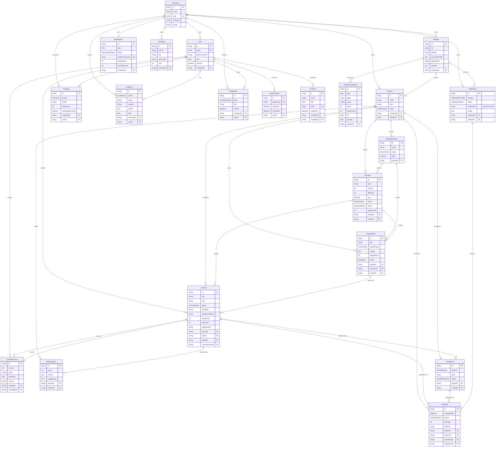

# Database

PostgreSQL 16 accessed through Prisma 6. This document describes the **actual** schema in [`prisma/schema.prisma`](../prisma/schema.prisma) — 21 models, 17 enums — with the tenancy rules every query must follow.

## Table of contents

- [1. Conventions](#1-conventions)
- [2. ER diagram](#2-er-diagram)
- [3. Tables](#3-tables)
  - [Tenant and identity](#tenant-and-identity)
  - [Websites and projects](#websites-and-projects)
  - [Keywords](#keywords)
  - [Content pipeline](#content-pipeline)
  - [Integrations and analytics](#integrations-and-analytics)
  - [AI usage, billing and operations](#ai-usage-billing-and-operations)
- [4. Enums](#4-enums)
- [5. Indexes and uniqueness](#5-indexes-and-uniqueness)
- [6. Tenancy rules](#6-tenancy-rules)
- [7. Migrations and seeding](#7-migrations-and-seeding)

## 1. Conventions

| Convention | Detail |
| --- | --- |
| Primary keys | `String @id @default(cuid())` everywhere — URL-safe, non-sequential |
| Timestamps | `createdAt @default(now())`; `updatedAt @updatedAt` on mutable rows |
| Tenant column | `companyId` on every tenant-owned root (`Website`, `Project`, `Integration`, `AIUsage`, …). Child rows reach the tenant through their parent (`Keyword → Project → Company`) |
| Delete behaviour | `Cascade` from owner to owned data; `SetNull` for soft references (author, brief, keyword, integration) so history survives |
| JSON columns | Used for flexible, AI-produced structures (`businessProfile`, `analysis`, `outline`, `checks`, `metadata`) — never for anything that needs a foreign key or an index |
| Money | `Decimal` (`cpc` 10,2; `estimatedCostUsd` 12,6) |
| Generated client | `packages/database/generated/client`, wrapped by `@acsp/database` |

## 2. ER diagram

## 3. Tables

### Tenant and identity

#### `Company` — the tenant

| Column | Type | Notes |
| --- | --- | --- |
| `id` | cuid | PK |
| `name`, `slug` | string | `slug` unique, URL identifier |
| `logoUrl`, `industry`, `description` | string? | profile |
| `timezone` | string | default `UTC`; used for scheduling and reports |
| `locale` | string | default `en` |

Owns: `users`, `websites`, `projects`, `integrations`, `subscription` (1:1), `aiUsage`, `auditLogs`, `notifications`, `files`. Deleting a company cascades to all of them.

#### `User`

| Column | Notes |
| --- | --- |
| `email` | globally unique — one account, one company |
| `passwordHash` | bcrypt (cost 12) |
| `role` | `Role`, default `COMPANY_USER` |
| `isActive` | soft disable without deleting history |
| `emailVerified`, `lastLoginAt` | timestamps |
| `companyId` | **nullable** — `SUPER_ADMIN` users have no company |

Relations: `refreshTokens`, `createdContents` (author), `contentVersions`, `auditLogs`, `notifications`, `aiUsage`, `invitesSent`.

#### `RefreshToken` — one row per session

| Column | Notes |
| --- | --- |
| `tokenHash` | unique SHA-256 of the refresh JWT; the raw token is never stored |
| `userAgent`, `ipAddress` | session metadata shown in "active sessions" |
| `expiresAt` | 7 days from issue |
| `revokedAt` | set on logout or rotation; `logout-all` revokes every row for the user |

#### `Invitation`

| Column | Notes |
| --- | --- |
| `email`, `role` | invited role can be anything except `SUPER_ADMIN` |
| `token` | unique random token in the email link |
| `expiresAt`, `acceptedAt` | accepted invitations are kept for audit |
| `companyId`, `invitedById` | unique on `(companyId, email)` — re-inviting updates the row |

### Websites and projects

#### `Website`

| Column | Notes |
| --- | --- |
| `name`, `url`, `domain` | `domain` unique per company |
| `businessProfile` | JSON: audience, tone, products, USPs, competitors |
| `brandVoice` | free text used in every prompt |
| `language`, `country` | defaults `en`, `US`; passed to research |
| `lastAnalyzedAt`, `analysis` | output of the `website-analysis` job |

Relations: `projects`, `integrations`, `analytics` (snapshots).

#### `Project`

| Column | Notes |
| --- | --- |
| `name`, `description`, `topic` | topic seeds keyword research |
| `goals` | JSON (traffic, leads, awareness…) |
| `status` | `ACTIVE`, `PAUSED`, `ARCHIVED` |
| `websiteId` | optional; `SetNull` when the website is deleted |

Contains: `keywords`, `keywordClusters`, `briefs`, `contents`, `seoAnalyses`, `socialPosts`, `schedules` — all cascade.

### Keywords

#### `KeywordCluster`

Groups keywords that one piece of content can target. `pillar` marks hub topics; `intent` is the dominant `SearchIntent`.

#### `Keyword`

| Column | Notes |
| --- | --- |
| `term` | unique per project |
| `volume`, `difficulty` (0–100), `cpc` | estimates; may be null |
| `intent` | `INFORMATIONAL`, `NAVIGATIONAL`, `COMMERCIAL`, `TRANSACTIONAL` |
| `status` | `DISCOVERED → SHORTLISTED → PLANNED → IN_PROGRESS → PUBLISHED`, or `IGNORED` |
| `opportunity` | 0–100 heuristic from the Research Agent |
| `source` | `ai`, `manual`, `gsc`, `import` |
| `clusterId` | optional |

### Content pipeline

#### `ContentBrief`

Plan for one piece: `title`, `contentType`, `intent`, `audience`, `tone`, `outline` (heading tree JSON), `targetWords` (default 1200), `secondaryKeywords[]`, `questions[]` (FAQ candidates), `competitors` JSON, `notes`, `status` (`DRAFT`, `READY`, `USED`). Links to an optional `keyword` and `cluster`.

#### `Content`

| Column | Notes |
| --- | --- |
| `title`, `slug` | slug unique per project |
| `contentType`, `status`, `language` | see enums |
| `excerpt`, `metaTitle`, `metaDescription`, `featuredImage` | SEO metadata |
| `wordCount`, `seoScore` | denormalised from the current version / latest analysis |
| `publishedUrl`, `publishedAt`, `approvedAt` | lifecycle timestamps |
| `briefId`, `keywordId`, `authorId` | soft references (`SetNull`) |
| `currentVersionId` | unique, points to the active `ContentVersion` |

#### `ContentVersion`

Immutable snapshots: `version` (unique per content), `body` (HTML/Markdown), `bodyJson` (Tiptap document), `summary` (what changed), `source` (`user`, `ai:generate`, `ai:rewrite`, `ai:improve`, …), `createdById`.

#### `SEOAnalysis`

One row per analyzer run: `score` (0–100), `checks` JSON `[{ key, label, passed, weight, message }]`, `suggestions`, `keyword` analysed against. Belongs to `content` and `project`.

#### `SocialPost`

Repurposed output: `platform`, `body`, `hashtags[]`, `mediaUrls[]`, `status`, `publishedUrl`, `publishedAt`. Optional link to the source `content`.

#### `Schedule`

The publishing unit: `scheduledFor`, `status` (`PENDING`, `PROCESSING`, `PUBLISHED`, `FAILED`, `CANCELED`), `attempts`, `lastError`, `result` JSON, `jobId` (BullMQ). Exactly one of `contentId` / `socialPostId` is set; `integrationId` selects the destination.

### Integrations and analytics

#### `Integration`

`provider` (`WORDPRESS`, `GOOGLE_SEARCH_CONSOLE`, `LINKEDIN`, `FACEBOOK`, `YOUTUBE`, `SHOPIFY`, `WEBFLOW`), `name`, `status`, **`credentials` — AES-256-GCM encrypted JSON string**, `config` JSON (site URL, property, default category…), `lastSyncAt`, `lastError`. Belongs to a company and optionally a website.

#### `AnalyticsSnapshot`

Daily Search Console rows: `date` (`@db.Date`), `page`, `query`, `clicks`, `impressions`, `ctr`, `position`, `source` (default `gsc`). Unique on `(websiteId, date, page, query, source)` so re-syncs upsert.

### AI usage, billing and operations

#### `AIUsage`

One row per model call: `feature` (`AIFeature`), `model`, `promptTokens`, `completionTokens`, `totalTokens`, `estimatedCostUsd` (12,6), `durationMs`, `jobId`, `metadata`. Attributed to a `company` and optionally a `user`.

#### `Subscription` — 1:1 with company

`plan`, `status`, `stripeCustomerId` / `stripeSubscriptionId` (unique), `currentPeriodStart/End`, `cancelAtPeriodEnd`, and the period counters `wordsUsed`, `aiCreditsUsed`.

#### `Notification`

`type`, `title`, `message`, `link`, `readAt`; per company and optionally per user.

#### `FileObject`

Tracks MinIO objects: `bucket`, `key` (unique together), `fileName`, `mimeType`, `size`, `url`.

#### `AuditLog`

`action` (`CREATE`, `UPDATE`, `DELETE`, `LOGIN`, `LOGOUT`, `PUBLISH`, `APPROVE`, `INVITE`, `BILLING`), `entity`, `entityId`, `before`, `after`, `ipAddress`, `userAgent`. `companyId` is nullable so platform-level actions by super admins are recorded too; `userId` is `SetNull` so logs outlive users.

## 4. Enums

| Enum | Values |
| --- | --- |
| `Role` | `SUPER_ADMIN`, `COMPANY_ADMIN`, `CONTENT_MANAGER`, `COMPANY_USER` |
| `Plan` | `FREE`, `STARTER`, `GROWTH`, `AGENCY` |
| `SubscriptionStatus` | `TRIALING`, `ACTIVE`, `PAST_DUE`, `CANCELED`, `INCOMPLETE` |
| `ProjectStatus` | `ACTIVE`, `PAUSED`, `ARCHIVED` |
| `KeywordStatus` | `DISCOVERED`, `SHORTLISTED`, `PLANNED`, `IN_PROGRESS`, `PUBLISHED`, `IGNORED` |
| `SearchIntent` | `INFORMATIONAL`, `NAVIGATIONAL`, `COMMERCIAL`, `TRANSACTIONAL` |
| `ContentType` | `BLOG_POST`, `LANDING_PAGE`, `PRODUCT_PAGE`, `GUIDE`, `LISTICLE`, `COMPARISON`, `NEWS` |
| `ContentStatus` | `BRIEF`, `GENERATING`, `DRAFT`, `IN_REVIEW`, `APPROVED`, `SCHEDULED`, `PUBLISHED`, `FAILED`, `ARCHIVED` |
| `BriefStatus` | `DRAFT`, `READY`, `USED` |
| `SocialPlatform` | `FACEBOOK`, `LINKEDIN`, `INSTAGRAM`, `X`, `YOUTUBE`, `EMAIL_NEWSLETTER`, `SHORT_VIDEO` |
| `SocialPostStatus` | `DRAFT`, `APPROVED`, `SCHEDULED`, `PUBLISHED`, `FAILED` |
| `ScheduleStatus` | `PENDING`, `PROCESSING`, `PUBLISHED`, `FAILED`, `CANCELED` |
| `IntegrationProvider` | `WORDPRESS`, `GOOGLE_SEARCH_CONSOLE`, `LINKEDIN`, `FACEBOOK`, `YOUTUBE`, `SHOPIFY`, `WEBFLOW` |
| `IntegrationStatus` | `CONNECTED`, `DISCONNECTED`, `ERROR`, `EXPIRED` |
| `AIFeature` | `KEYWORD_RESEARCH`, `WEBSITE_ANALYSIS`, `CONTENT_BRIEF`, `CONTENT_GENERATION`, `CONTENT_EDIT`, `SEO_ANALYSIS`, `REPURPOSING`, `QUALITY_CHECK`, `REPORT` |
| `NotificationType` | `INFO`, `SUCCESS`, `WARNING`, `ERROR` |
| `AuditAction` | `CREATE`, `UPDATE`, `DELETE`, `LOGIN`, `LOGOUT`, `PUBLISH`, `APPROVE`, `INVITE`, `BILLING` |

Each enum is mirrored as a string-literal union in `packages/shared/src/enums.ts` so the browser never imports Prisma.

## 5. Indexes and uniqueness

| Table | Unique | Indexes | Why |
| --- | --- | --- | --- |
| `Company` | `slug` | `slug` | tenant lookup by slug |
| `User` | `email` | `companyId`, `email` | login; list users per tenant |
| `RefreshToken` | `tokenHash` | `userId`, `expiresAt` | refresh lookup; purge expired |
| `Invitation` | `(companyId, email)`, `token` | `token` | accept by token; one open invite per address |
| `Website` | `(companyId, domain)` | `companyId` | one website per domain per tenant |
| `Project` | — | `companyId`, `websiteId` | tenant listing |
| `KeywordCluster` | — | `projectId` | |
| `Keyword` | `(projectId, term)` | `(projectId, status)`, `clusterId` | dedupe research; kanban by status |
| `ContentBrief` | — | `projectId` | |
| `Content` | `(projectId, slug)`, `currentVersionId` | `(projectId, status)` | slug per project; pipeline boards |
| `ContentVersion` | `(contentId, version)` | `contentId` | history |
| `SEOAnalysis` | — | `contentId`, `projectId` | latest score per content |
| `SocialPost` | — | `(projectId, platform)`, `contentId` | |
| `Schedule` | — | `(scheduledFor, status)`, `projectId` | the publisher's "due now" scan |
| `Integration` | — | `(companyId, provider)` | |
| `AnalyticsSnapshot` | `(websiteId, date, page, query, source)` | `(websiteId, date)` | idempotent sync; date-range dashboards |
| `AIUsage` | — | `(companyId, createdAt)`, `feature` | monthly usage; per-feature cost |
| `Subscription` | `companyId`, `stripeCustomerId`, `stripeSubscriptionId` | — | webhooks look up by Stripe ids |
| `Notification` | — | `(userId, readAt)`, `companyId` | unread badge |
| `FileObject` | `(bucket, key)` | `companyId` | |
| `AuditLog` | — | `(companyId, createdAt)`, `(entity, entityId)` | tenant log; entity history |

## 6. Tenancy rules

1. **Every query on a tenant-owned entity filters by `companyId` taken from the JWT** — never from the request body or query string (except `SUPER_ADMIN` with an explicit `?companyId=`).
2. Child entities are reached **through** their owner: `prisma.keyword.findMany({ where: { project: { id, companyId } } })`. Never trust a bare `projectId` from the client without joining to the tenant.
3. A record that exists but belongs to another tenant returns **404**, not 403, so tenants cannot probe each other's ids.
4. `User.companyId` is nullable only for `SUPER_ADMIN`. Application code treats `companyId === null` on any other role as a data error.
5. Uniqueness that matters for tenants is scoped: `(companyId, domain)`, `(projectId, term)`, `(projectId, slug)`. Global uniqueness applies only to identity (`User.email`, `Company.slug`) and secrets (`tokenHash`, `token`).
6. Background jobs receive `companyId` in the payload and re-verify that the target rows still belong to that company before writing.
7. Plan limits are checked against counts scoped to the company (`websites`, `projects`, `users`) or to the subscription period (`wordsUsed`, `aiCreditsUsed`, keywords, social posts).

## 7. Migrations and seeding

| Command | Purpose |
| --- | --- |
| `pnpm db:generate` | regenerate the Prisma client (also runs on `postinstall`) |
| `pnpm db:migrate` | create/apply a migration in development (`prisma migrate dev`) |
| `pnpm db:deploy` | apply pending migrations in production (`prisma migrate deploy`) |
| `pnpm db:push` | push the schema without a migration — quick local start only |
| `pnpm db:reset` | drop, recreate, migrate and seed |
| `pnpm db:seed` | run `prisma/seed.ts` |
| `pnpm db:studio` | open Prisma Studio |

Migration hygiene:

- One migration per PR, named after the change (`20260927_add_websites`).
- Additive first (new nullable column → backfill → make required) so deploys stay zero-downtime; see [DEPLOYMENT.md](./DEPLOYMENT.md#8-zero-downtime-releases).
- Never edit an applied migration; add a new one.

Seed data (`prisma/seed.ts`, idempotent upserts):

| Login | Role | Company |
| --- | --- | --- |
| `admin@platform.local` / `Password123!` | `SUPER_ADMIN` | — |
| `owner@acme.local` / `Password123!` | `COMPANY_ADMIN` | Acme Demo Co (`acme-demo`, Growth plan) |
| `editor@acme.local` / `Password123!` | `CONTENT_MANAGER` | Acme Demo Co |

Plus a website "Acme Marketing Site", a project "Q4 Organic Growth" and a pillar cluster "CRM for small business".
