# Roadmap

Seven delivery phases. Each phase ships as a series of small PRs — one module at a time — following the branch and commit conventions in [`CONTRIBUTING.md`](../CONTRIBUTING.md). Tick items as they merge to `main`.

## Table of contents

- [Status summary](#status-summary)
- [Phase 1 — Auth + SaaS core ✅](#phase-1--auth--saas-core-)
- [Phase 2 — Projects & Keywords](#phase-2--projects--keywords)
- [Phase 3 — AI Content](#phase-3--ai-content)
- [Phase 4 — SEO & Editor](#phase-4--seo--editor)
- [Phase 5 — Repurposing](#phase-5--repurposing)
- [Phase 6 — Analytics & Integrations](#phase-6--analytics--integrations)
- [Phase 7 — Billing & Production](#phase-7--billing--production)
- [Later](#later)

## Status summary

| Phase | Scope | Modules | Status |
| --- | --- | --- | --- |
| 1 | Auth + SaaS core | auth, users, companies, audit, admin, health, worker skeleton, docker, CI, docs | ✅ shipped (`0.1.0`) |
| 2 | Projects & Keywords | websites, projects, keywords, research | 🔜 up next |
| 3 | AI Content | briefs, content generation, files | planned |
| 4 | SEO & Editor | seo analyzer, editor, AI actions, versions | planned |
| 5 | Repurposing | repurposing, social posts, calendar | planned |
| 6 | Analytics & Integrations | integrations, publishing (WordPress), Search Console analytics, reports | planned |
| 7 | Billing & Production | subscriptions (Stripe), usage, notifications, hardening | planned |

## Phase 1 — Auth + SaaS core ✅

Goal: a deployable multi-tenant skeleton with real authentication, tenancy, auditing and the operational baseline every later module relies on.

- [x] Monorepo: pnpm workspaces + Turborepo, `tsconfig.base.json`, Prettier/ESLint, `.editorconfig`, `.nvmrc`
- [x] Prisma schema (21 models, 17 enums) with tenancy constraints and indexes; seed script with demo accounts
- [x] `@acsp/shared`: enums, Zod schemas (auth, company, website, project, keyword, content, common), `PLAN_LIMITS`, `Permissions` + `hasPermission`, `QUEUES` + job payload types, API types; Vitest tests
- [x] `@acsp/database`: generated Prisma client wrapper
- [x] API: NestJS app with global prefix `/api/v1`, `ValidationPipe`, exception filter, Swagger at `/api/docs`, throttling, `/health`
- [x] Auth module: register (user + company + free subscription), login, refresh rotation with hashed tokens, logout, logout-all, me, change password; httpOnly cookies + bearer
- [x] Guards and decorators: `JwtAuthGuard`, `@Public()`, `RolesGuard`, `@Roles()`, `@CurrentUser()`; tenant scoping; super-admin `?companyId=`
- [x] Users module: CRUD, invitations (`invite`, `invitations`, `accept-invite`), plan `users` limit
- [x] Companies module: `me`, update, `me/usage`, super-admin listing/detail/update/delete
- [x] Audit module: `AuditService` used by every mutation, `GET /audit`
- [x] Admin module: `GET /admin/stats`
- [x] Web: Next.js 15 App Router with `(marketing)`, `(auth)`, `(dashboard)` groups, shadcn-style UI kit, `api-client` with refresh-on-401, login/register/accept-invite forms, dashboard shell, settings (company, team), admin stats page
- [x] Worker skeleton: one BullMQ worker per queue, graceful shutdown, `AIUsage` recorder, OpenAI client wrapper, processor stubs
- [x] Docker: `docker-compose.yml` (postgres, redis, minio), `docker-compose.prod.yml` (nginx, web, api, worker + data), Dockerfiles, Nginx config
- [x] CI: GitHub Actions — install, lint, typecheck, test, build
- [x] Docs: PRD, architecture, database, API, security, AI agents, testing, deployment, roadmap, user journey, conventions, animated README assets

## Phase 2 — Projects & Keywords

Goal: a company can describe its website, open a project and get an AI keyword plan.

- [ ] `websites` module: CRUD, `(companyId, domain)` uniqueness, plan `websites` limit, business profile JSON validation
- [ ] `website-analysis` processor: safe fetcher (SSRF guard, size cap), Research Agent `analyzeWebsite`, store `Website.analysis`
- [ ] `projects` module: CRUD, status, plan `projects` limit
- [ ] `keywords` module: list/filter, manual add, CSV import, status transitions, clusters CRUD
- [ ] `keyword-research` processor: Research Agent discover → cluster → score; upsert by `(projectId, term)`; `keywordsPerMonth` accounting
- [ ] `research` read models: cluster overview, opportunity board
- [ ] Jobs endpoint: `GET /jobs/:queue/:jobId` for polling
- [ ] Web: websites list/new/detail (profile form, analysis card), projects list/new/detail, keyword table with filters and bulk status, cluster view, "Research with AI" dialog with job progress
- [ ] Tests: integration for all endpoints incl. cross-tenant, processor tests with fixtures
- [ ] Docs: API tables flipped to live, DATABASE notes if schema changes

## Phase 3 — AI Content

Goal: from a shortlisted keyword to a complete AI draft.

- [ ] `content` module part 1: briefs CRUD, `generate: true` via SEO Agent, statuses `DRAFT → READY → USED`
- [ ] `content` module part 2: create from brief → `GENERATING` + job, manual drafts, list/detail with current version
- [ ] `content-generation` processor: Orchestrator recipe (Writing → SEO → Quality → optional revise), version 1, initial `SEOAnalysis`, `wordsUsed` accounting, notifications
- [ ] `files` module: MinIO presigned uploads, `FileObject`, featured images
- [ ] `ai` module in API: OpenAI wrapper for synchronous small tasks, shared pricing/usage code with the worker
- [ ] Web: brief editor (outline tree, FAQs, secondary keywords), "Generate article" with live job state, content list by status
- [ ] Tests, docs

## Phase 4 — SEO & Editor

Goal: humans can edit, improve and score content before approval.

- [ ] Editor (Tiptap) with toolbar, headings, links, images from MinIO, autosave to a user version
- [ ] AI actions: rewrite, improve, shorten, expand, translate, optimize SEO, generate CTA — selection-aware, each creates a version with `source = ai:<action>`
- [ ] Version history: list, diff, restore
- [ ] `seo` module: heuristic analyzer (title, meta, H1, density, headings, links, readability, FAQ coverage, images), `SEOAnalysis` history, `suggest-metadata`
- [ ] SEO side panel with live checks and one-click fixes
- [ ] Content status workflow `DRAFT → IN_REVIEW → APPROVED` with `approvedAt` and `AuditLog(APPROVE)`
- [ ] Tests, docs

## Phase 5 — Repurposing

Goal: every article becomes a set of distribution assets on a calendar.

- [ ] `repurposing` processor with platform profiles: Facebook, LinkedIn, Instagram caption, X, YouTube script, email newsletter, short-video script
- [ ] `social-posts` endpoints: list, edit, approve, delete; `socialPostsPerMonth` accounting
- [ ] Calendar: month/week views, drag to reschedule, filters by project/platform (read model over `Schedule`)
- [ ] Web: repurpose dialog, post cards with per-platform previews and character counters
- [ ] Tests, docs

## Phase 6 — Analytics & Integrations

Goal: publish to the real world and measure results.

- [ ] `integrations` module: encrypted credentials (AES-256-GCM), connection test, plan `integrations` limit, OAuth start/callback
- [ ] WordPress adapter: application passwords, create/update post, categories/tags, featured image upload
- [ ] `publishing` module: schedules, delayed jobs, publish-now, retry, cancel; `Approve → Schedule → Publish` enforced
- [ ] `publishing` processor: idempotent publish, `publishedUrl`, `AuditLog(PUBLISH)`, failure notifications
- [ ] Google Search Console adapter + `analytics-sync` processor (daily incremental, upsert snapshots)
- [ ] `analytics` module: overview, pages, keywords, matched to content/keywords; `report-generation` processor (PDF/CSV to MinIO)
- [ ] Web: integrations settings, connect flows, analytics dashboards, per-content performance, reports page
- [ ] Later adapters (behind the same interface): LinkedIn, Facebook, YouTube, Shopify, Webflow
- [ ] Tests (fake WordPress server, recorded GSC responses), docs

## Phase 7 — Billing & Production

Goal: charge for the product and run it safely at scale.

- [ ] `subscriptions` module: plan catalogue, Stripe Checkout, customer portal, webhooks (`checkout.session.completed`, `invoice.paid`, `customer.subscription.updated/deleted`), period counter reset
- [ ] Limit enforcement everywhere with `402` + upgrade CTA; premium model and priority queue for Growth/Agency
- [ ] `usage` module: AI usage listing and totals; cost alerts
- [ ] `notifications` module: in-app center, unread badge, SSE stream, email digests
- [ ] Password reset flow, email verification, active sessions UI
- [ ] Production hardening: helmet/CSP, Redis-backed throttling, SSRF guard, log shipping, Sentry, health dashboards, backup automation, restore drill
- [ ] Super-admin dashboard: companies, usage, queues, failed jobs retry, audit across tenants
- [ ] Agency features: white-label reports, audit log export
- [ ] E2E suite on the full user journey in CI
- [ ] `1.0.0` release

## Later

- Team workflows: comments, assignments, approval roles per project
- Content refresh loop: detect decaying pages from GSC and propose updates automatically
- Additional data providers for keyword volume; competitor SERP analysis
- Multi-language projects with per-locale publishing targets
- Public API keys and webhooks for customers
- Kubernetes manifests / Helm chart as an alternative to Compose
