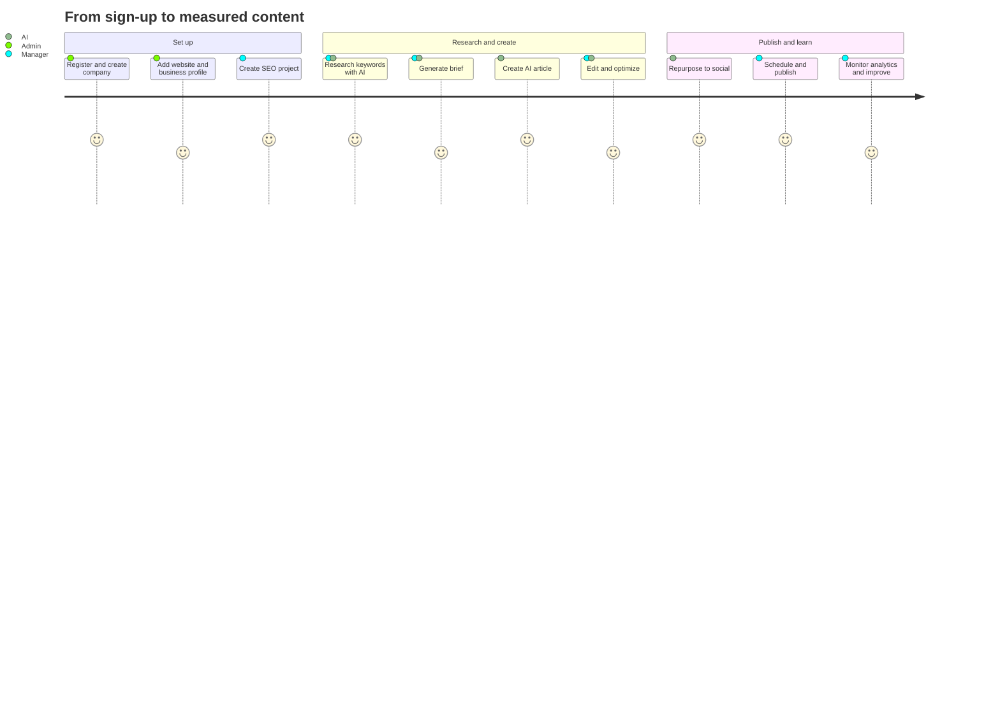

# User Journey

The end-to-end path of a new customer, from creating an account to improving content based on real search data. Each step lists the UI, the API calls, the background jobs and the data written, so it doubles as the specification for the E2E test suite.

## Table of contents

- [Overview](#overview)
- [Step 1 — Register and create a company](#step-1--register-and-create-a-company)
- [Step 2 — Add a website and business profile](#step-2--add-a-website-and-business-profile)
- [Step 3 — Create an SEO project](#step-3--create-an-seo-project)
- [Step 4 — Research keywords with AI](#step-4--research-keywords-with-ai)
- [Step 5 — Generate a content brief](#step-5--generate-a-content-brief)
- [Step 6 — Create an AI article](#step-6--create-an-ai-article)
- [Step 7 — Edit and optimize](#step-7--edit-and-optimize)
- [Step 8 — Repurpose to social](#step-8--repurpose-to-social)
- [Step 9 — Schedule and publish](#step-9--schedule-and-publish)
- [Step 10 — Monitor analytics and improve](#step-10--monitor-analytics-and-improve)
- [Secondary journeys](#secondary-journeys)

## Overview



| Step | Actor | Phase | Status |
| --- | --- | --- | --- |
| 1 Register & create company | Company admin | 1 | ✅ live |
| 2 Add website & business profile | Company admin | 2 | planned |
| 3 Create SEO project | Content manager | 2 | planned |
| 4 Research keywords with AI | Content manager | 2 | planned |
| 5 Generate brief | Content manager | 3 | planned |
| 6 Create AI article | Content manager | 3 | planned |
| 7 Edit & optimize | Content manager | 4 | planned |
| 8 Repurpose to social | Content manager | 5 | planned |
| 9 Schedule & publish | Content manager | 6 | planned |
| 10 Monitor analytics & improve | Everyone | 6 | planned |

---

## Step 1 — Register and create a company

**Goal:** a working account with a tenant, logged in.

- **UI:** `/register` in the `(auth)` route group. Form fields from `registerSchema`: name, email, password (8+ chars, upper, lower, number), company name.
- **API:** `POST /api/v1/auth/register` → creates `User(role=COMPANY_ADMIN)`, `Company(slug from name)`, `Subscription(plan=FREE)` in one transaction; sets `access_token` and `refresh_token` cookies; returns `{ user, tokens }`.
- **Then:** `GET /api/v1/auth/me` hydrates the dashboard shell. The admin can invite teammates from Settings → Team (`POST /users/invite`), who accept at `/accept-invite?token=…` (`POST /users/accept-invite`).
- **Data written:** `User`, `Company`, `Subscription`, `RefreshToken`, `AuditLog(LOGIN)`.
- **Done when:** the dashboard shows the company name and an empty-state "Add your first website".

## Step 2 — Add a website and business profile

**Goal:** the platform knows what the business is and who it talks to.

- **UI:** Websites → New. Fields: name, URL, language, country, brand voice, business profile (audience, tone, products/services, USPs, competitors).
- **API:** `POST /api/v1/websites`, then optional `POST /api/v1/websites/:id/analyze`.
- **Job:** `website-analysis` — fetches the homepage and key pages, asks the Research Agent to summarise positioning, audience and content gaps; stores `Website.analysis` and `lastAnalyzedAt`; records `AIUsage(WEBSITE_ANALYSIS)`.
- **Data written:** `Website`, `AIUsage`, `Notification` on completion.
- **Done when:** the website card shows "Analyzed" with the AI summary.

## Step 3 — Create an SEO project

**Goal:** a container for a campaign with a topic and goals.

- **UI:** Projects → New. Fields: name, website, topic, goals (traffic, leads, awareness), description.
- **API:** `POST /api/v1/projects`.
- **Data written:** `Project(status=ACTIVE)`.
- **Done when:** the project overview shows the keyword, brief, content and calendar tabs.

## Step 4 — Research keywords with AI

**Goal:** a prioritised keyword plan grouped by intent.

```
Topic → Research Agent → Keyword Clusters → Search Intent → Content Strategy → Content Brief
```

- **UI:** Project → Keywords → "Research with AI"; enter topic and optional seed keywords; watch job progress.
- **API:** `POST /api/v1/projects/:projectId/keywords/research` → `202 Accepted { jobId }`.
- **Job:** `keyword-research` — Research Agent proposes clusters (`pillar`, `intent`) and keywords with estimated volume, difficulty and an `opportunity` score; upserts by `(projectId, term)`; decrements `keywordsPerMonth` allowance.
- **Data written:** `KeywordCluster`, `Keyword(status=DISCOVERED, source=ai)`, `AIUsage(KEYWORD_RESEARCH)`.
- **Human control:** the manager shortlists (`SHORTLISTED`), ignores or manually adds keywords; sorts by opportunity.
- **Done when:** at least one cluster has shortlisted keywords.

## Step 5 — Generate a content brief

**Goal:** an agreed plan for one piece of content.

- **UI:** Keyword or cluster → "Create brief". The SEO Agent proposes title, content type, intent, audience, tone, outline (heading tree), target word count, secondary keywords and FAQ questions. Everything is editable.
- **API:** `POST /api/v1/projects/:projectId/briefs` (with `generate: true`) → `ContentBrief(status=DRAFT)`; `PATCH …/briefs/:id` to edit; set `status=READY`.
- **Data written:** `ContentBrief`, `AIUsage(CONTENT_BRIEF)`.
- **Done when:** the brief is `READY`.

## Step 6 — Create an AI article

**Goal:** a complete first draft grounded in the brief and brand voice.

- **UI:** Brief → "Generate article". Progress is streamed as job state (queued → generating → done).
- **API:** `POST /api/v1/content` with `briefId` → `Content(status=GENERATING)` and `202 { jobId }`.
- **Job:** `content-generation` — Orchestrator runs Writing Agent (draft) → SEO Agent (meta title/description, headings) → Quality Agent (readability, repetition, completeness vs. outline). Stores `ContentVersion 1 (source=ai:generate)`, sets `currentVersionId`, `wordCount`, `status=DRAFT`; marks brief `USED`; adds words to `Subscription.wordsUsed`.
- **Data written:** `Content`, `ContentVersion`, `SEOAnalysis` (initial), `AIUsage(CONTENT_GENERATION, QUALITY_CHECK)`, `Notification`.
- **Done when:** the editor opens with the draft and an initial SEO score.

## Step 7 — Edit and optimize

**Goal:** a publish-ready article the team is happy with.

- **UI:** Content editor (Tiptap-based) with AI actions on selection or document: **rewrite · improve · shorten · expand · translate · optimize SEO · generate CTA**; SEO panel with live checks; version history sidebar.
- **API:** `POST /api/v1/content/:id/ai` `{ action, selection? }` → new version; `POST /api/v1/seo/analyze` `{ contentId, keyword }` → `SEOAnalysis`; `PATCH /api/v1/content/:id` for metadata; `POST /api/v1/content/:id/versions/:versionId/restore`.
- **Data written:** `ContentVersion(source=ai:<action>|user)`, `SEOAnalysis`, `Content.seoScore`, `AIUsage(CONTENT_EDIT, SEO_ANALYSIS)`.
- **Done when:** status is moved to `IN_REVIEW` and then `APPROVED` (`approvedAt` set, `AuditLog(APPROVE)`).

## Step 8 — Repurpose to social

**Goal:** distribution assets derived from the article.

- **UI:** Content → Repurpose → pick platforms: Facebook, LinkedIn, Instagram caption, X post, YouTube script, email newsletter, short-video script.
- **API:** `POST /api/v1/content/:id/repurpose` `{ platforms }` → `202 { jobId }`.
- **Job:** `repurposing` — one `SocialPost(status=DRAFT)` per platform with body, hashtags and suggested media; counts towards `socialPostsPerMonth`.
- **Data written:** `SocialPost`, `AIUsage(REPURPOSING)`.
- **Done when:** posts are reviewed and set to `APPROVED`.

## Step 9 — Schedule and publish

**Goal:** the article is live on the website, posts go out on time.

```
Approve → Schedule → Publish
```

- **UI:** Calendar → drag the approved article to a date/time and pick the WordPress integration; do the same for social posts. Requires a connected `Integration` (Settings → Integrations → WordPress URL + application password; credentials are encrypted at rest).
- **API:** `POST /api/v1/publishing/schedules` `{ contentId | socialPostId, integrationId, scheduledFor }` → `Schedule(status=PENDING)`; the API enqueues a delayed `publishing` job.
- **Job:** `publishing` — loads the schedule, decrypts credentials, pushes to WordPress REST (`/wp-json/wp/v2/posts`), stores `publishedUrl`, `publishedAt`, `Schedule.result`; on failure stores `lastError`, retries (3 attempts, exponential backoff), notifies.
- **Data written:** `Schedule`, `Content(status=SCHEDULED → PUBLISHED)`, `SocialPost`, `AuditLog(PUBLISH)`, `Notification`.
- **Done when:** the content card shows the live URL.

## Step 10 — Monitor analytics and improve

**Goal:** know what worked and feed it back into the plan.

- **UI:** Analytics → connect Google Search Console (OAuth) → dashboards for clicks, impressions, CTR, average position, top pages, keyword performance; per-content performance on the content page; downloadable reports.
- **API:** `GET /api/v1/analytics/overview?websiteId&from&to`, `GET /api/v1/analytics/pages`, `GET /api/v1/analytics/keywords`, `POST /api/v1/analytics/reports`.
- **Jobs:** `analytics-sync` daily per connected website (incremental by date), `report-generation` on demand (PDF/CSV stored in MinIO as `FileObject`).
- **Data written:** `AnalyticsSnapshot`, `Integration.lastSyncAt`, `FileObject`.
- **Loop:** keywords that rank 5–20 are flagged as "improve" opportunities; the manager opens the article, runs *optimize SEO*, republishes an update — back to Step 7.

---

## Secondary journeys

| Journey | Entry point | Notes |
| --- | --- | --- |
| Invite a teammate | Settings → Team | `POST /users/invite`, email with token, `POST /users/accept-invite`; invitations expire and are unique per `(companyId, email)` |
| Change password | Settings → Security | `PATCH /auth/password` with current + new password; all other sessions can be revoked with `POST /auth/logout-all` |
| Upgrade plan | Settings → Billing or any 402 limit error | Stripe checkout → webhook → `Subscription.plan`; limits apply immediately |
| Super admin oversight | `/admin` | `GET /admin/stats`, `GET /companies`, `GET /audit` across tenants; act on a tenant with `?companyId=` |
| Recover from a failed job | Notification → job detail | Retry button re-enqueues with the same payload; errors are shown verbatim from `lastError` |
